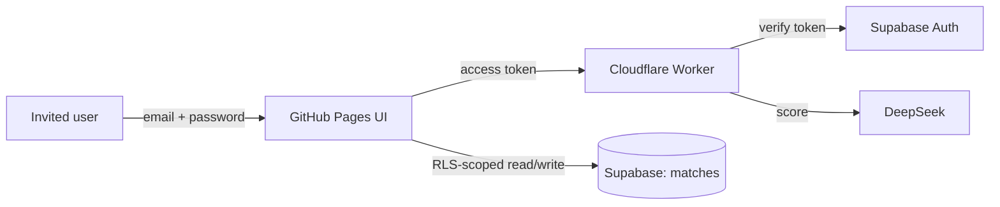

# Invite-only access (Supabase)

Phase 1 stack: **GitHub Pages** (static UI) + **Cloudflare Worker** (DeepSeek
scoring) + **Supabase** (login + per-user records). Free tier, no domain needed.

Login is invite-only: **public sign-up is disabled**, so accounts exist only when
an admin invites them from the Supabase dashboard.

## 1. Create the project

1. https://supabase.com → New project (free). Note the project URL and the
   **anon public** key (Project Settings → API).
2. **Auth → Providers → Email**: enabled.
3. **Auth → Sign In / Providers → Email**: turn **off** "Allow new users to
   sign up" (invite-only).
4. **Auth → Users → Invite user** to add someone by email. On the free tier,
   email is rate-limited (~a few/hour); if you hit it, an admin can set a
   password directly in the dashboard instead.
5. **SQL Editor** → paste and run [`../supabase/schema.sql`](../supabase/schema.sql).
   This creates `public.matches` with Row Level Security so users see only their
   own rows.

## 2. Configure the site

Edit [`config.js`](config.js):

```js
window.SUPABASE_URL = "https://<project-ref>.supabase.co";
window.SUPABASE_ANON_KEY = "<anon public key>";
```

The anon key is safe to ship in a public site — RLS protects the data, not
secrecy of the key. Once both are set, every page loads [`auth.js`](auth.js),
which redirects signed-out visitors to [`login.html`](login.html).

Leave both blank to keep the previous behavior (no login; records via the
Worker's token-protected store).

## 3. Lock the Worker to logged-in users

The Worker endpoints spend DeepSeek credits, so require a login there too.

```sh
cd ../worker
# add these to wrangler.jsonc "vars" (or as secrets), then:
npx wrangler deploy
```

Set `SUPABASE_URL` and `SUPABASE_ANON_KEY` in `worker/wrangler.jsonc`. When both
are present, `POST /` and `POST /score` reject requests without a valid Supabase
access token (verified against `.../auth/v1/user`).

Then set `PERSIST_D1 = "false"` so scored results live only in Supabase (no
second copy of candidate PII in D1), and redeploy.

## How it fits together



- **Scoring** stays on the Worker (it holds the DeepSeek key).
- **Records** live in Supabase, owned per user, enforced by RLS.
- **Invites** are managed in the Supabase dashboard.

## Moving to Cloudflare Access later

Records export as CSV/JSON from the records page and re-import cleanly. Auth does
not: Supabase passwords don't carry over to Cloudflare Access, so users would be
re-invited. Only worth doing if you buy a domain and want Access or a custom URL.
